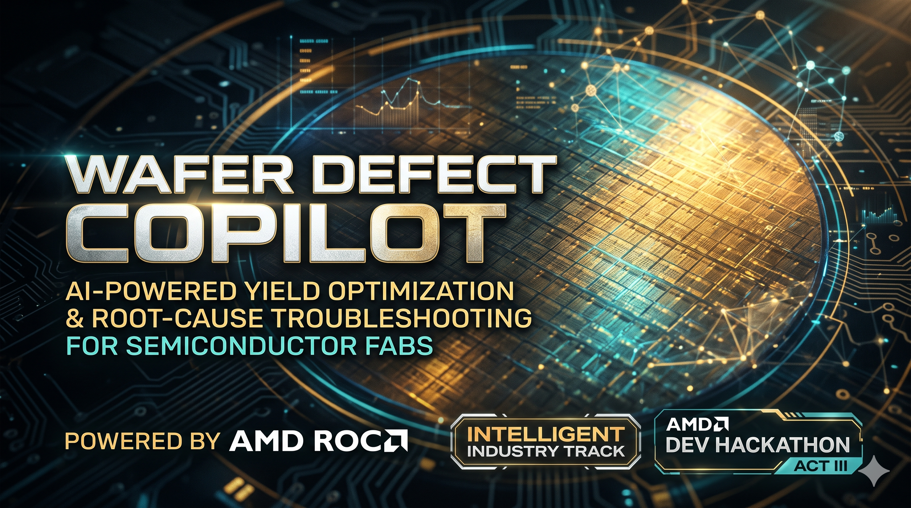
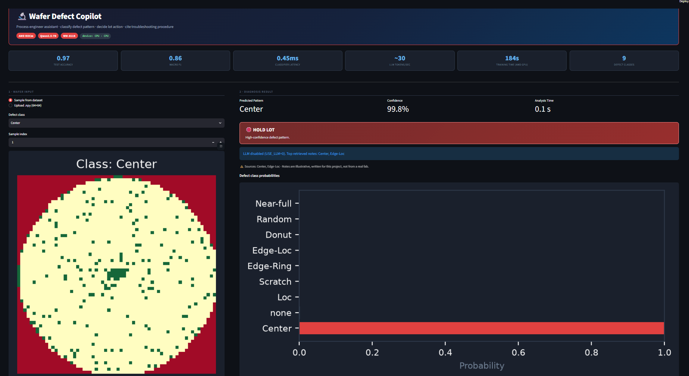
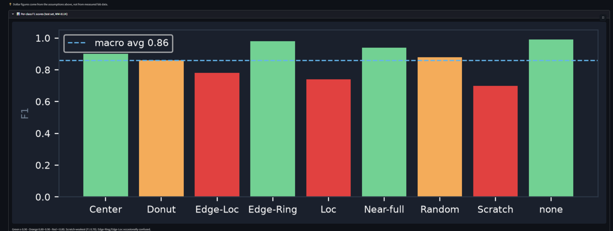
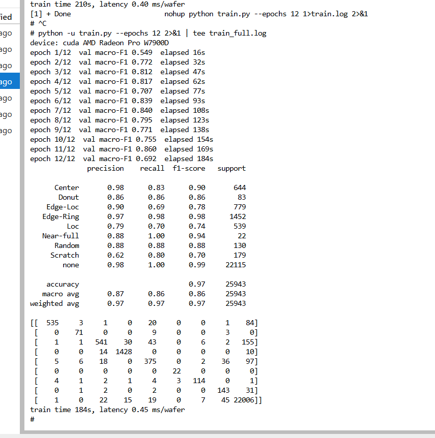
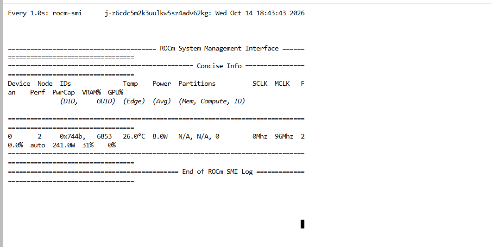

# Wafer Defect Copilot


A process-engineer assistant for semiconductor fabs. It takes a wafer map, classifies the defect
pattern, applies an action threshold (hold lot / review / no action), retrieves a matching
troubleshooting note, and has a **locally hosted LLM** write a cited recommendation. No external
LLM API is used; inference runs on AMD hardware.

**User:** a night-shift process engineer who today scans wafer maps by eye and searches SOPs by hand.



## Pipeline
wafer map -> CNN classifier -> action threshold -> embedding retrieval over notes -> Qwen2.5-7B-Instruct -> alert + recommendation

## AMD Technologies Used
- **AMD Radeon Pro W7900D** on AMD Radeon Cloud (Jupyter), ROCm build of PyTorch (`2.13.0+rocm10.0.0`)
- CNN training, classifier inference, sentence embeddings and LLM generation all run on the GPU (`device = "cuda"`, which maps to ROCm/HIP)
- ROCm-based Dockerfile (`rocm/pytorch` base image)
- Proof: The screenshots below validate the 12-epoch training run on the W7900D and the Qwen2.5 LLM VRAM utilization.

**Hardware Proof:**



## Results (WM-811K, 172,950 labeled wafers, stratified 70/15/15 split)
| Metric | Value |
|---|---|
| Test accuracy | 0.97 |
| Test macro-F1 | 0.86 |
| Training time (12 epochs, AMD GPU) | 184 s |
| Classifier latency | 0.45 ms per wafer |
| LLM generation (Qwen2.5-7B, fp16) | about 30 tokens/s |

Weakest classes: Scratch (F1 0.70), Loc (0.74), Edge-Loc (0.78). Rare classes such as Near-full (22 test wafers)
and Donut (83) have noisy scores.
## Run it
```bash
pip install -r requirements.txt          # plus the ROCm build of torch
# files needed next to app.py: wafer_cnn.pt, metrics.json, (optional) wm811k_64.npz
streamlit run app.py
```
Settings are environment variables (no secrets in the repo): `LLM_NAME`, `USE_LLM` (set `0` to skip the LLM on a laptop),
`MODEL_PATH`, `METRICS_PATH`, `DATA_PATH`.

Docker:
```bash
docker build -t wafer-copilot .
docker run --device=/dev/kfd --device=/dev/dri --group-add video -p 8501:8501 wafer-copilot
```

## Retrain
`python train.py --epochs 12` (uses the GPU when available).

## Limitations (honest notes)
- Troubleshooting notes are illustrative and written for this project, not taken from a real fab. Recommendations are phrased as "likely causes to check".
- Edge-Ring and Edge-Loc are sometimes confused (see the confusion matrix in `train_full.log`).
- ROI figures in the dashboard come from editable assumptions, not measured fab data.
- WM-811K is a public dataset; check its license before redistributing.
